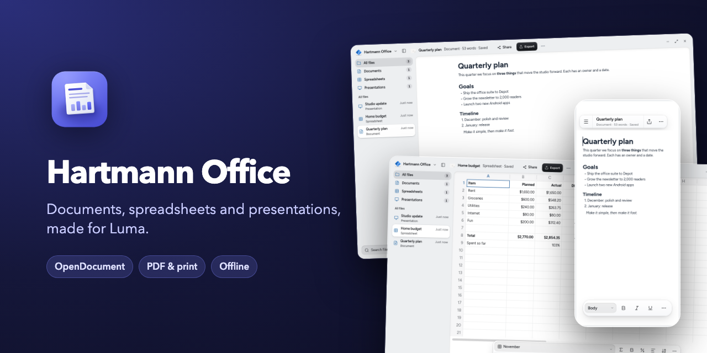
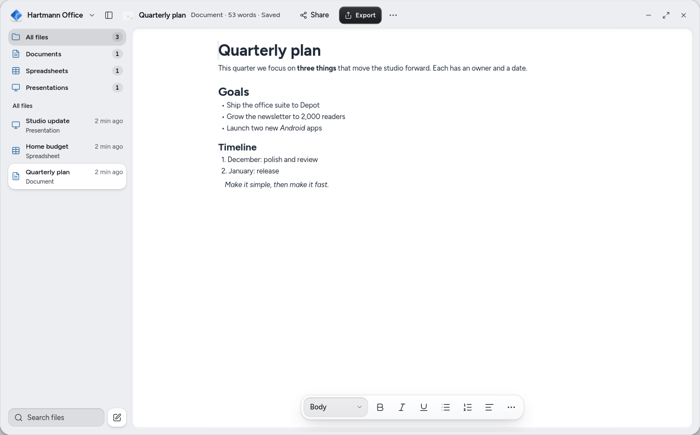
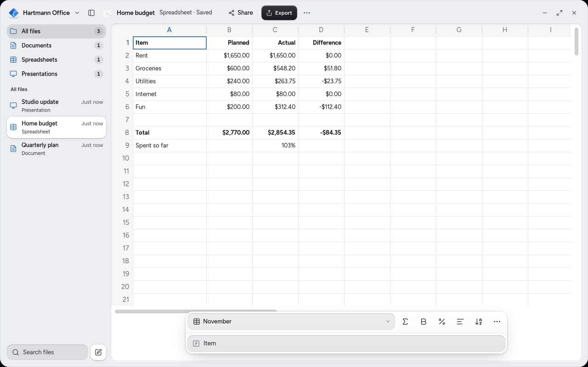
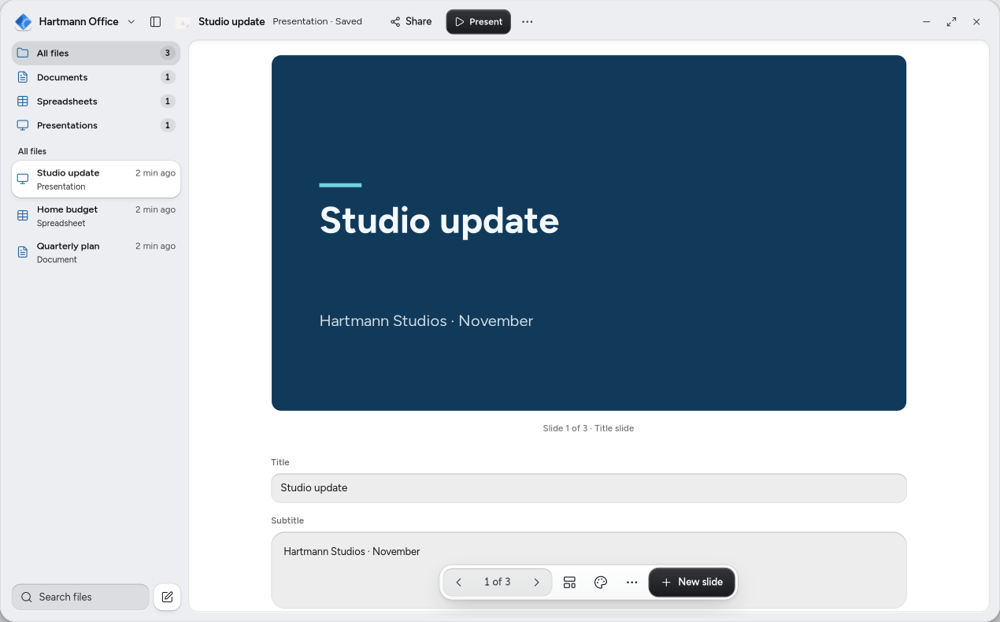
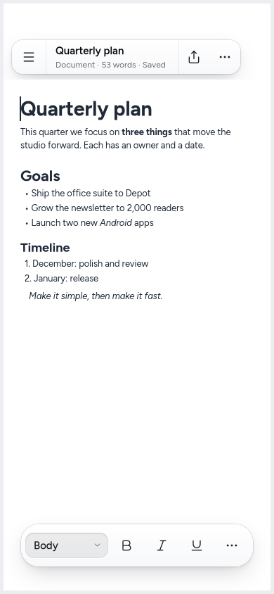

<p align="center">
  
</p>

<p align="center">
  <a href="https://github.com/chartmann1590/hartmann-office/actions/workflows/tests.yml"></a>
  <a href="LICENSE"></a>
  <a href="https://simplyluma.com"></a>
  
</p>

# Hartmann Office

**Documents, spreadsheets and presentations in one app made for [Luma](https://simplyluma.com).**
Built with LumaUI, it fits a computer, a tablet and a phone. It works offline, needs no account and collects nothing.

## Features

<table>
  <tr>
    <td width="50%"></td>
    <td width="50%"></td>
  </tr>
  <tr>
    <td><b>Documents</b>: title, headings, lists, quotes, bold, italic, underline, strikethrough and
      alignment; live word count; find and replace; Letter or A4 pages.</td>
    <td><b>Spreadsheets</b>: more than 50 functions (SUM, IF, VLOOKUP, SUMIF, PMT, DATE…), several sheets,
      number formats, sorting, fill down, insert and delete rows and columns, copy and paste. The bar
      doubles as the formula bar.</td>
  </tr>
  <tr>
    <td></td>
    <td align="center"></td>
  </tr>
  <tr>
    <td><b>Presentations</b>: title, points and section slides; five themes; speaker notes;
      full screen Present mode.</td>
    <td><b>Everywhere</b>: the same app on a phone, with touch, pointer and keyboard.</td>
  </tr>
</table>

### Files

- Saves as you go. Deleted files wait 30 days in **Deleted** before they're gone.
- OpenDocument files (`.odt`, `.ods`, `.odp`) that LibreOffice, Microsoft Office and others open, plus CSV and Markdown.
- Export any file to PDF, or print it.
- Files live in the app's own folder and move in and out through the system file picker. The app has no
  network or filesystem access ([privacy policy](PRIVACY.md)).

## Keyboard

| Keys | Does |
| --- | --- |
| <kbd>Ctrl</kbd>+<kbd>N</kbd> · <kbd>Ctrl</kbd>+<kbd>Shift</kbd>+<kbd>N</kbd> · <kbd>Ctrl</kbd>+<kbd>Alt</kbd>+<kbd>N</kbd> | New document · spreadsheet · presentation |
| <kbd>Ctrl</kbd>+<kbd>O</kbd> · <kbd>Ctrl</kbd>+<kbd>Shift</kbd>+<kbd>S</kbd> | Open · Save a copy |
| <kbd>Ctrl</kbd>+<kbd>E</kbd> · <kbd>Ctrl</kbd>+<kbd>P</kbd> | Export as PDF · Print |
| <kbd>F5</kbd> | Present |
| <kbd>Ctrl</kbd>+<kbd>Z</kbd> · <kbd>Ctrl</kbd>+<kbd>Shift</kbd>+<kbd>Z</kbd> | Undo · Redo |
| <kbd>Ctrl</kbd>+<kbd>B</kbd> · <kbd>Ctrl</kbd>+<kbd>I</kbd> · <kbd>Ctrl</kbd>+<kbd>U</kbd> | Bold · Italic · Underline |
| <kbd>Ctrl</kbd>+<kbd>1</kbd>–<kbd>3</kbd> · <kbd>Ctrl</kbd>+<kbd>0</kbd> | Heading 1–3 · Body text |
| <kbd>Ctrl</kbd>+<kbd>F</kbd> | Find and replace |
| <kbd>F2</kbd> or start typing | Edit the selected cell |
| <kbd>Ctrl</kbd>+<kbd>D</kbd> | Fill down |
| <kbd>F9</kbd> | Show or hide the sidebar |

## Install

Hartmann Office is headed for **Depot**, Luma's app store. Until it's listed, you can build it yourself.

## Build

You need the Luma SDK on `x86_64` (on Luma, or any Linux with Flatpak):

```sh
flatpak remote-add --if-not-exists luma https://dl.simplyluma.com/luma.flatpakrepo
flatpak install luma org.projectluma.Platform//44 org.projectluma.Sdk//44
flatpak-builder --user --install --install-deps-from=luma build-dir flatpak/com.charleshartmann.Office.json
flatpak run com.charleshartmann.Office
```

## Tests

```sh
python3 -m pytest tests/test_formula.py tests/test_odf.py       # formula engine and file formats, any Python 3.12+
xvfb-run flatpak run --command=python3 org.projectluma.Sdk//44 tests/test_ui.py   # the real editors, in the Luma runtime
luma lint && luma test                                            # Luma's app checks
```

## Project layout

```
src/hoffice/
  app.py       window, sidebar, bars and commands
  writer.py    document editor
  sheet.py     spreadsheet grid
  formula.py   formula engine (no GTK, fully unit tested)
  slides.py    slide editor and presenter
  odf.py       OpenDocument, CSV and Markdown
  render.py    page layout for PDF, printing and slides
  library.py   the file library and Deleted
data/          desktop file, AppStream metainfo, icon
flatpak/       Flatpak manifest
```

## Contributing

Bug reports and ideas are welcome: [open an issue](https://github.com/chartmann1590/hartmann-office/issues/new/choose).
See [CONTRIBUTING.md](CONTRIBUTING.md) before sending a pull request.

## Licence

[GPL-3.0-or-later](LICENSE). Copyright © 2026 Hartmann Studios.
